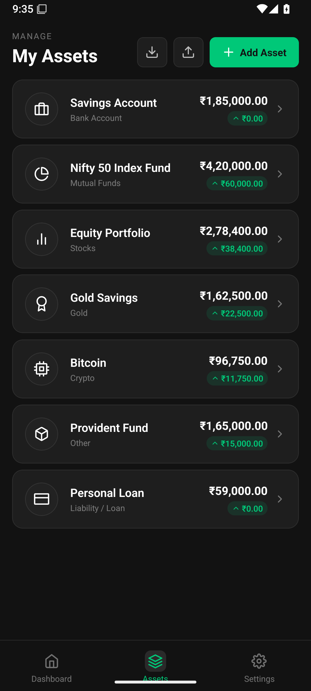
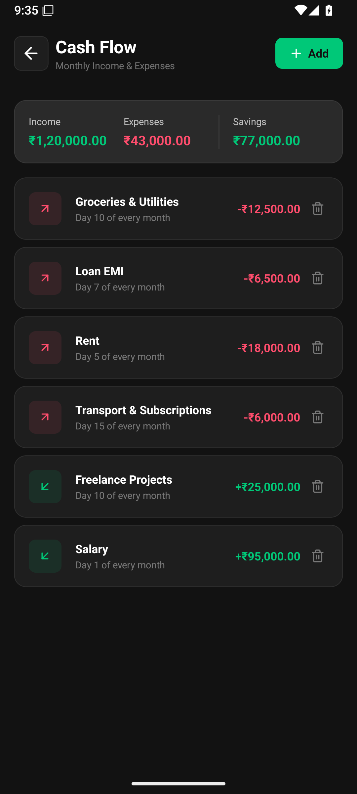

# NetWorth

An offline-first personal net worth and portfolio tracker built with Expo and React Native. Track investments, bank balances, physical assets, loans, and monthly cash flow in a dark mobile interface, with values displayed in Indian rupees.

The app stores portfolio records in SQLite on the device. It uses device biometrics or the device passcode when supported and enrolled. There is no Google sign-in, Supabase account, or hosted application backend to configure.

## Screenshots

Screens use fictional sample data.
<p>
  
  
  
</p>

## Features

- **Net worth dashboard:** portfolio value, liabilities, category allocations, and monthly income, expenses, and savings. Hide balances with the visibility control.
- **Asset tracking:** stocks, crypto, mutual funds, gold, real estate, ETFs, bank accounts, physical assets, loans, and other assets.
- **Transactions and SIPs:** record purchases and sales, inspect asset history, and configure recurring investment schedules.
- **Valuation:** Yahoo Finance price lookups for supported symbols, manual-price fallbacks, currency conversion, and physical-asset depreciation calculations.
- **Projections:** portfolio growth charts using historical or category-default growth assumptions.
- **Cash flow:** manage recurring monthly income and expenses.
- **Local backup:** export portfolio records to JSON through the device share sheet and restore a JSON backup from the Assets screen.
- **Optional Gemini insights:** provide your own API key and model in Settings for portfolio analysis and the dashboard executive summary.

Market prices and AI features require internet access. Projections use assumptions and are estimates, not guaranteed returns. Core portfolio records remain available locally.

## Run the app

Use a current Node.js LTS release supported by the pinned Expo SDK, npm, and an Android device or emulator with a compatible Expo Go version.

```bash
git clone https://github.com/glitch-xp/networth-tracker.git
cd networth-tracker
npm ci
npm start
```

Scan the QR code with Expo Go on Android, or press `a` in the Expo terminal to open an available Android emulator. The project currently pins Expo SDK 57 and React Native 0.86; use an Expo Go release compatible with SDK 57.

```bash
npm run android
```

No `.env` file is required for the core app. Start with an empty portfolio, add assets from the Assets tab, then record transactions in an asset's detail screen. Use the dashboard's **Manage** action to add cash-flow entries.

On a device without enrolled biometrics, the app opens without a biometric prompt. Local authentication and sharing should be checked on a physical device before distributing a build.

### Optional AI setup

Enter your own Gemini API key and a model available to your account in **Settings**. The key starts empty in the source. The current settings store is in memory; do not assume the key or model selection persists across restarts.

When AI features are used, the app authenticates requests to Google's Gemini service with that key. Price lookups contact Yahoo Finance. There is no requirement to configure Google OAuth or Google sign-in.

### Android APK builds

`eas.json` includes a preview profile that produces an APK:

```bash
npx eas-cli build --platform android --profile preview
```

An EAS account and project access are required. `app.json` contains the original application's public EAS project ID, owner, and Android package name. For a fork, link your own EAS project and use your own package name before building. Signing credentials belong in EAS or local secret storage, never in Git.

## Source layout

```text
App.js                  Navigation, initialization, and local authentication
src/screens/            Dashboard, assets, asset details, cash flow, settings, unlock
src/database/schema.js  SQLite schema, data operations, and JSON backup/restore
src/store/              Portfolio state and valuation updates
src/services/           Yahoo Finance, Gemini, and SIP evaluation
src/components/         Projection chart
src/utils/              Cache and projection calculations
assets/                 App icons and splash assets
```

## Development checks

```bash
npx expo export --platform android
```

This verifies Android JavaScript bundling; it does not create a signed APK. The repository does not currently define a test or lint script. Device-only behavior still needs native testing.

## Privacy and repository hygiene

SQLite portfolio records stay on the device unless exported or processed by an enabled external integration. JSON backups contain financial records; handle them as private files. Runtime caches, local databases, portfolio exports, environment files, signing keys, and generated build artifacts are excluded from Git. `src/utils/cache.js` is application source and is intentionally tracked.

## License

[MIT](LICENSE).
