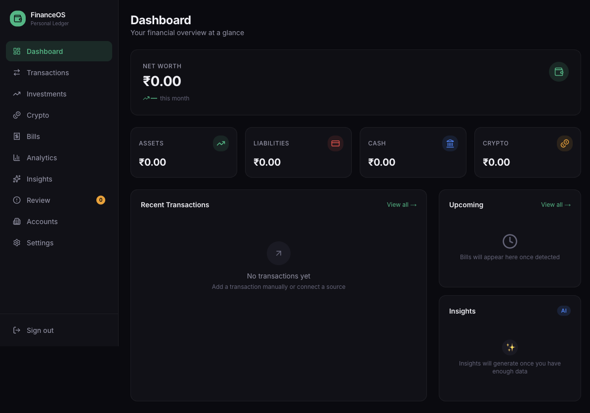
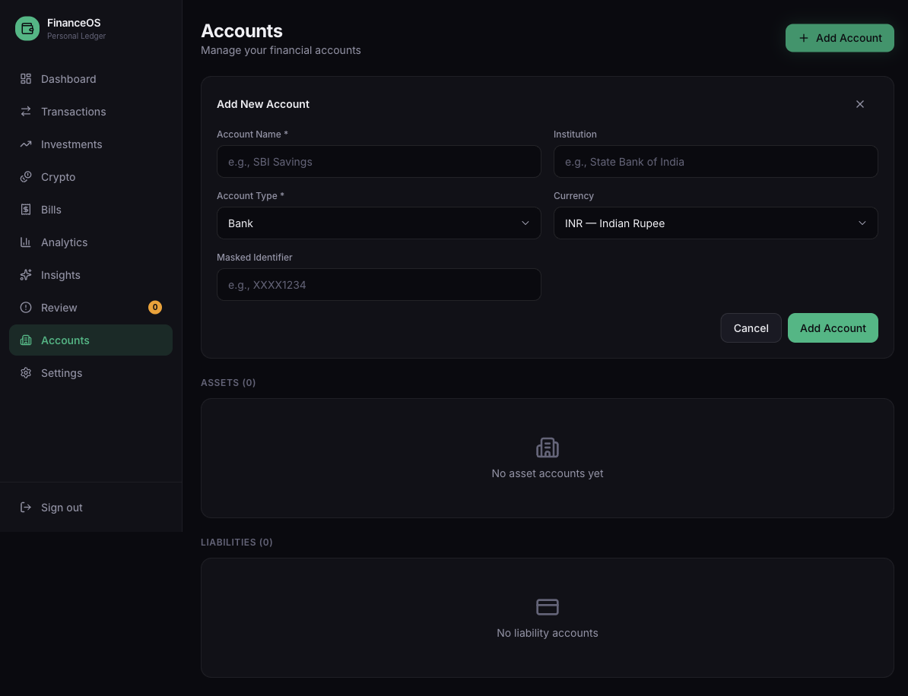
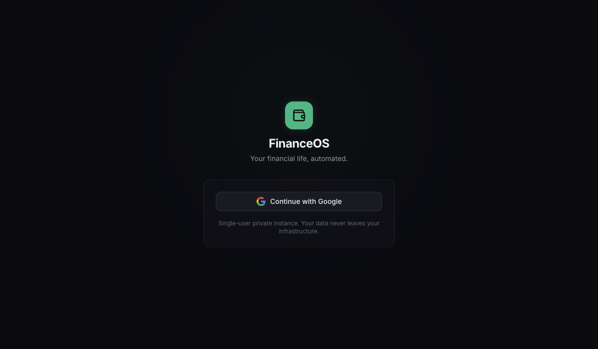

# FinanceOS · Networth Tracker

A personal finance web app for bringing accounts, balances, and transactions into one ledger. FinanceOS calculates net worth from assets minus liabilities, shows a financial overview in Indian rupees, and includes ingestion pipelines for bank SMS and Gmail receipts.

This is an early-stage, single-user project. The `main` branch contains the Next.js web app; an earlier Expo/Android app is preserved on [`backup/local-master-20261025`](https://github.com/glitch-xp/networth-tracker/tree/backup/local-master-20261025).

## Screenshots

Captured from the actual web UI in an isolated local preview with empty data. Database responses were stubbed and authentication was disabled **only in the temporary screenshot copy**; the published app still requires Supabase authentication. No personal accounts, transactions, or credentials are shown.

### Dashboard

Net worth, assets, liabilities, cash, and recent transactions at a glance. Crypto totals and the upcoming-bills and insights panels are placeholders in this version.



### Accounts

Organize asset and liability accounts, including banks, credit cards, loans, cash, brokers, mutual funds, and crypto wallets.



### Sign in

Google sign-in through Supabase Auth.



## What is implemented

- **Financial overview:** net worth and asset/liability totals calculated from the latest stored account balance snapshots, plus recent transactions and a pending-review count.
- **Account management:** create, edit, and deactivate accounts; store institution, currency, account type, and a masked identifier.
- **Transaction ledger:** manual transaction entry and a searchable, filterable transaction list.
- **Review queue:** inspect uncertain entries and confirm, edit, void, or ignore them.
- **SMS ingestion:** a MacroDroid setup screen and an ingestion endpoint with HMAC verification, timestamp checks, replay protection, parsing, and deduplication logic.
- **Gmail integration:** OAuth connection, read-only message retrieval, parsing, incremental sync, and a scheduled reconciliation route.
- **AI parsing support:** a server-side Gemini provider and privacy-filtering utilities.

The integration code requires provider credentials and database setup. Its presence does not mean those services are connected in a fresh installation.

## Still in progress

Investments, live crypto valuation, bills and subscriptions, spending analytics, and the AI Insights page currently display placeholders. Broker connections, financial goals, and security/export tools are also planned. Account currencies can be selected, but the dashboard currently formats totals in INR and does not implement foreign-exchange conversion.

## Run locally

Use Node.js 20.9 or later and npm.

```bash
git clone https://github.com/glitch-xp/networth-tracker.git
cd networth-tracker
npm ci
cp .env.example .env.local
```

1. Create a Supabase project and run the SQL files in `supabase/migrations/` in filename order using its SQL Editor.
2. Set `NEXT_PUBLIC_SUPABASE_URL` and `NEXT_PUBLIC_SUPABASE_ANON_KEY` in `.env.local`.
3. Enable Google as an authentication provider in Supabase. Configure its Google OAuth credentials and allow `http://localhost:3000/auth/callback` as an application redirect URL. Use the callback URL supplied by Supabase when configuring the Google OAuth client.
4. Start the app:

```bash
npm run dev
```

Open [localhost:3000](http://localhost:3000) and sign in with Google.

### Optional integrations

| Integration | Environment variables | Setup |
| --- | --- | --- |
| Gmail | `GOOGLE_CLIENT_ID`, `GOOGLE_CLIENT_SECRET`, `NEXT_PUBLIC_APP_URL` | Enable Gmail API, configure the read-only Gmail scope, and register `<app-url>/api/gmail/callback` as a Google OAuth redirect. Connect from Settings. |
| Gmail background sync | `SUPABASE_SERVICE_ROLE_KEY`, `CRON_SECRET` | Configure the scheduler to call `/api/cron/gmail-sync` with `Authorization: Bearer <CRON_SECRET>`. `vercel.json` declares a 15-minute schedule. |
| Gmail push notifications | `GMAIL_PUBSUB_TOPIC` | Optional Google Cloud Pub/Sub topic and push subscription; polling is available without it. |
| MacroDroid SMS | `MACRODROID_DEVICE_SECRET` | Follow the signing and request instructions in Settings. |
| Gemini parsing | `GEMINI_API_KEY`, optionally `GEMINI_MODEL` and `AI_PROVIDER` | Set server-side credentials; `AI_PROVIDER` defaults to `gemini`. |

The example environment file lists the core settings; add the optional variables above only for integrations you configure. Replace localhost with your deployed URL in production OAuth settings.

## Stack and source layout

Next.js 16 App Router, React 19, TypeScript, Tailwind CSS 4, Supabase Auth/PostgreSQL, Google APIs, and Gemini.

```text
src/app/              Pages, authentication callbacks, and API routes
src/components/       Shared layout and navigation
src/features/         Accounts, transaction ledger, and review queue
src/lib/ingestion/    SMS parsing, signature checks, and deduplication
src/lib/gmail/        Gmail client, parsing, and ingestion pipeline
src/lib/ai/           Gemini provider and privacy utilities
src/lib/supabase/     Database clients and types
supabase/migrations/  Database schema and access policies
docs/screenshots/     README screenshots
```

## Development

```bash
npm run lint
npm run build
npm start
```

`npm start` serves a completed production build. See [the product specification](personal_financial_os_prd.md) for the broader roadmap; it includes features beyond the current implementation.

## Credentials and data

Keep real credentials in `.env.local` or your hosting provider's secret settings. Only the Supabase URL and anonymous key belong in `NEXT_PUBLIC_*` variables; service-role keys, OAuth client secrets, Gemini keys, and device secrets must remain server-side. The repository ignores local environment files, private-key files, build output, and caches. `.env.example` contains placeholders only.

Gmail and Gemini are external services: enabled integrations exchange data with those providers. Review the authentication, token storage, ingestion routes, and database policies before using this early-stage app with sensitive financial data.
